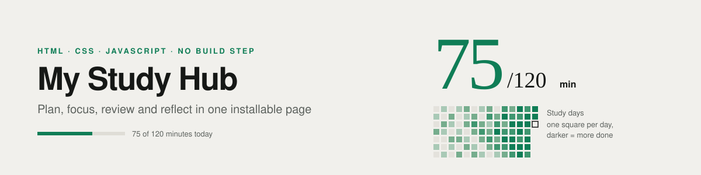
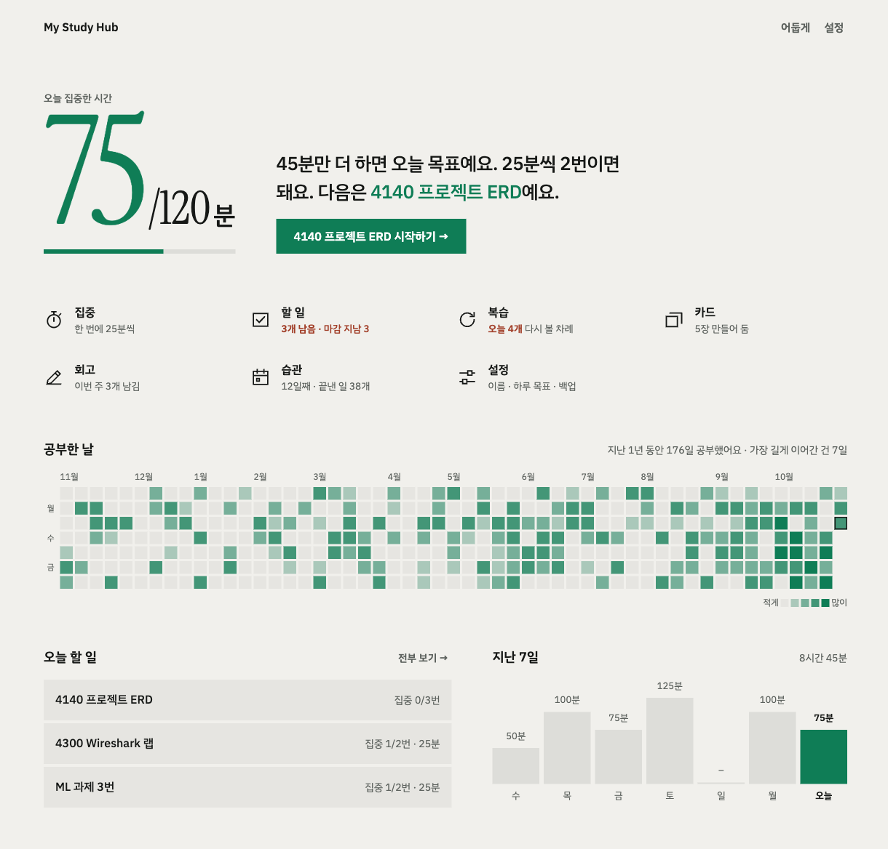
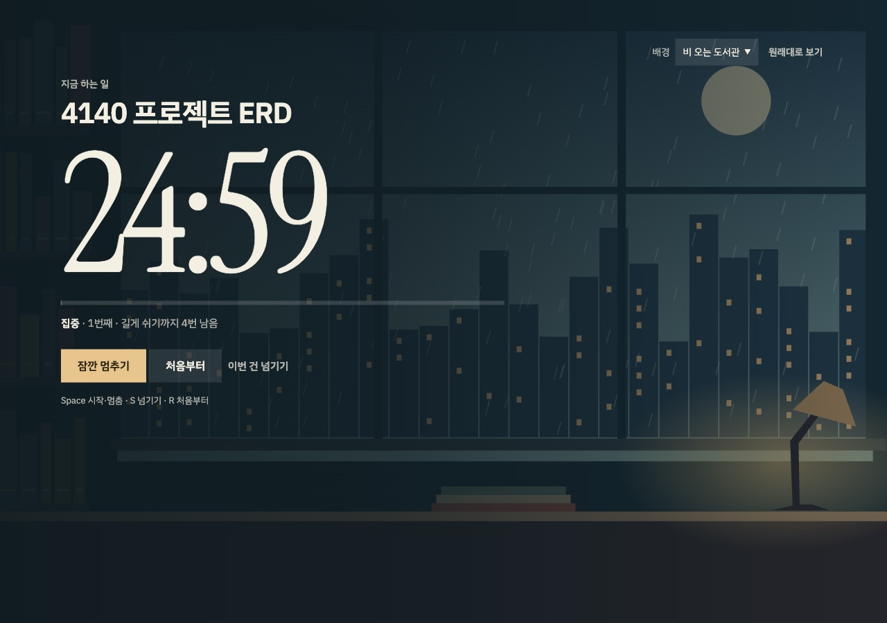
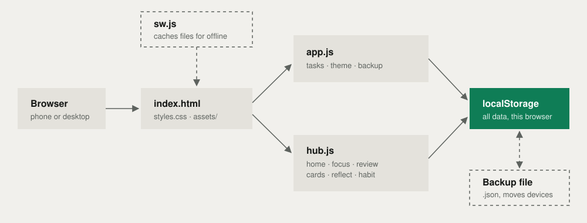

<div align="center">




[English](README.md) · **한국어**

개인 프로젝트 · 2026년 3월 · 2026년 11월 리디자인

**[앱 열기 →](https://devjwk.github.io/my-study-hub/)**

[만든 이유](#만든-이유) · [기능](#기능) · [설계](#설계) · [맡은 일](#맡은-일) · [한계](#한계와-다음-단계) · [실행](#실행)

</div>

---

> **현재 상태 — 동작하는 앱**
> GitHub Pages에 배포되어 있어요. 홈 화면에 설치할 수 있고, 오프라인에서도 열려요.
> 데이터는 브라우저 하나에만 저장되고, 아직 기기 간 동기화는 없어요.

| | |
|---|---|
| 기간 | 2026년 3월 (리디자인 2026년 11월) |
| 팀 | 개인 |
| 기술 | HTML, CSS, JavaScript (프레임워크 없음), Service Worker, localStorage, GitHub Pages |



<sub>예시 데이터를 넣은 홈 화면.</sub>

## 만든 이유

공부하는 하루가 할 일 앱, 포모도로 타이머, 플래시카드 앱, 메모 파일로 흩어져 있었어요. 앱을 오갈 때마다 집중이 끊겼고, 앱끼리는 서로의 기록을 몰랐어요. My Study Hub는 이 흐름을 한곳에 모았어요.

| 계획 | 집중 | 복습 | 회고 |
| :--- | :--- | :--- | :--- |
| 중요도·태그·마감·목표 세션이 있는 할 일 | 할 일과 연결되는 포모도로 타이머 | 복습 목록과 플래시카드 | 이해도 기록, 연속 기록, 1년치 공부한 날 |

## 기능

| 영역 | 기능 |
| :--- | :--- |
| **오늘(홈)** | 하루 목표 대비 오늘 집중한 시간, 다음에 할 일 한 줄 안내, 모든 기능 한 번에 이동, 1년치 공부한 날 잔디, 지난 7일 |
| **할 일** | 중요도, 태그, 마감 날짜·시간, 집중 목표 횟수, 검색, 필터, 정렬, 수정, 끝낸 일 개수와 목표 단계 |
| **집중** | 집중 / 짧게 쉬기 / 길게 쉬기, 할 일과 연결된 세션, 새로고침해도 이어하기, 화면 가득 일러스트 배경, 단축키 |
| **복습** | 얼마나 쉬웠는지에 따라 7일·3일·1일 뒤에 다시 보기 |
| **카드** | 질문과 답 플래시카드, 눌러서 뒤집기 |
| **회고** | 얼마나 이해했는지와 짧은 메모 |
| **습관** | 연속 공부한 날, 직접 체크, 26주 잔디 |
| **설정** | 이름, 하루 목표, 배경색(색 7가지 또는 직접 고르기, 진하기 조절), 밝게·어둡게, 전체 백업과 복원 |

집중 끝내기, 복습하기, 회고 남기기, 할 일 끝내기, 직접 체크하기가 모두 그날 칸에 쌓여요. 잔디 기능이 생기기 전 날짜는 집중 기록과 회고 기록으로 채워요.



<sub>비 오는 도서관 배경으로 화면 가득 집중하기.</sub>

## 설계

빌드 단계도 서버도 없어요. 정적 파일을 서비스워커가 캐시하고, 모든 데이터는 브라우저에 저장돼요.



2026년 11월 리디자인에서 정한 원칙:

- **화면마다 큰 숫자 하나.** 홈은 오늘 집중한 시간이 가장 크고, 나머지는 작게 둬요.
- **직각, 선 최소화.** 둥근 모서리가 없고 테두리도 거의 없어요. 구역은 여백과 면 색으로 나눠요.
- **대표색 하나.** 설정에서 고른 색이 배경에 섞이고, 숫자·막대·버튼·잔디의 강조색이 돼요. 두 테마 모두에서 글자 대비가 4.5:1 이상이 되도록 밝기를 자동으로 맞춰요. 붉은색은 경고에만 써요.
- **글꼴 두 가지.** 글은 IBM Plex Sans KR, 숫자는 Instrument Serif.
- **말하듯 쓴 문구.** 버튼과 안내 문구를 사람이 말하는 것처럼 썼어요.
- **상대 경로.** 같은 파일이 도메인 루트에서도, GitHub Pages 같은 하위 경로에서도 그대로 동작해요.

## 맡은 일

개인 프로젝트: 기획, 화면 설계, 구현, 배포 설정.

## 배운 점

- 프레임워크 없이 상태와 화면을 맞추는 법 (`js/app.js`, `js/hub.js`)
- 서비스워커로 정적 파일을 캐시해 오프라인에서도 열리게 하는 법
- 웹 앱 매니페스트로 페이지를 설치할 수 있게 만드는 법
- `localStorage` 데이터 백업·복원과 저장 키 관리
- 접근성 기본: 주요 버튼에 `aria-label`
- Netlify 보안·캐시 헤더 설정 (`netlify.toml`)

## 참고 자료

- MDN Web Docs: Service Worker, Web App Manifest, Web Storage
- Netlify 문서

## 결과

| 빌드 단계 | npm 패키지 | 설치 | 오프라인 |
| :---: | :---: | :---: | :---: |
| **없음** | **0개** | **홈 화면** | **지원** |

`index.html`을 그대로 배포하면 돼요.

## 한계와 다음 단계

| 한계 | 다음 단계 |
| :--- | :--- |
| 데이터가 브라우저 하나의 `localStorage`에만 있음 | 기기 간 동기화. 지금은 백업 파일로 옮겨야 해요 |
| 복습 간격이 고정 (7일·3일·1일) | 기억할수록 간격이 늘어나는 방식 |
| 자동화 테스트 없음 | 할 일, 타이머, 대표색 계산 단위 테스트 |
| `hub.js`가 약 1,500줄 | 기능별 모듈로 나누기 |

## 실행

```bash
python3 -m http.server 8000
```

`http://localhost:8000`을 열면 돼요. 서비스워커는 `localhost`나 HTTPS에서만 동작해요.

**배포.** GitHub Pages가 `main` 브랜치의 루트를 그대로 배포해요(`.nojekyll`로 파일을 손대지 않게 함). Netlify로 배포할 수 있도록 `netlify.toml`도 남겨뒀어요.
