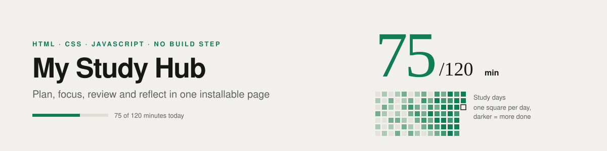
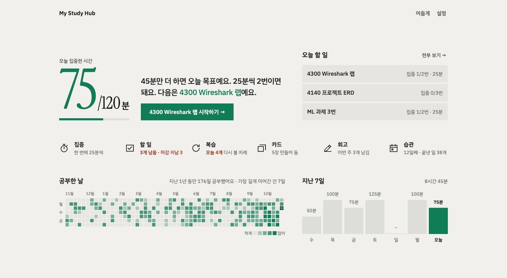
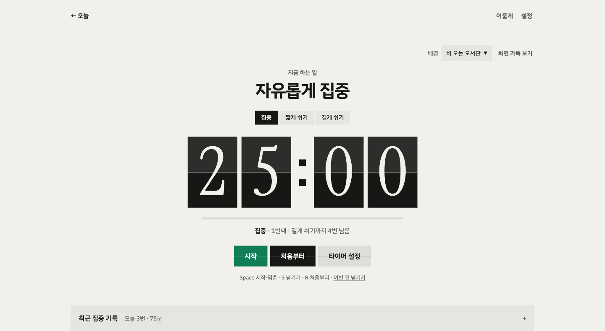
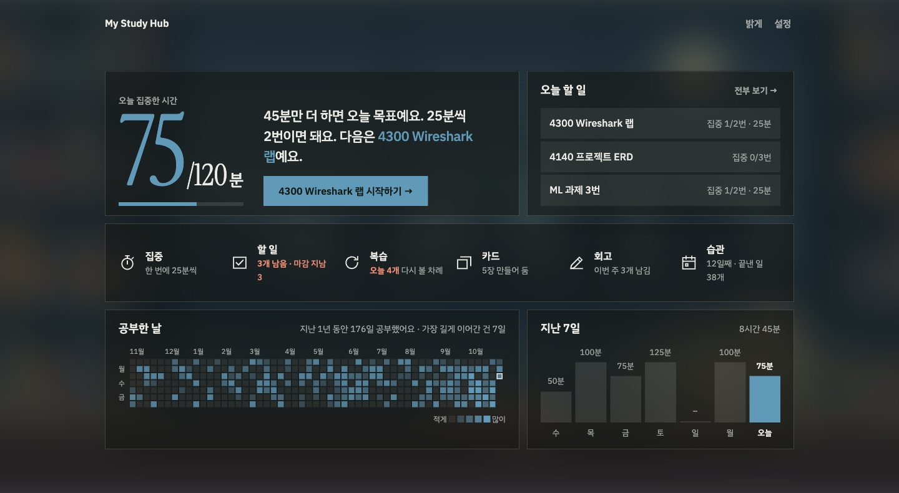
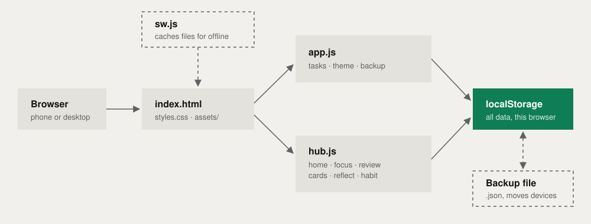

<div align="center">




**English** · [한국어](README.ko.md)

Personal project · March 2026 · redesigned November 2026

**[Open the app →](https://devjwk.github.io/my-study-hub/)**

[Why](#why) · [What it does](#what-it-does) · [Design](#design) · [My role](#my-role) · [Limitations](#limitations-and-next-steps) · [Run it](#run-it)

</div>

---

> **Where it stands — working app**
> Live on GitHub Pages. It installs to the home screen and opens offline.
> Data stays in one browser; there is no sync between devices yet.

| | |
|---|---|
| Period | March 2026 (redesign November 2026) |
| Team | Individual |
| Stack | HTML, CSS, JavaScript (no framework), Service Worker, localStorage, GitHub Pages |



<sub>Home in a default laptop Chrome window (1440×790), shown with sample data. The interface is in Korean.</sub>

## Why

My study day was spread across a to-do app, a pomodoro timer, a flashcard app and a notes file. Switching between them cost attention, and none of them knew about the others. My Study Hub puts the whole loop in one place.

| Plan | Focus | Review | Reflect |
| :--- | :--- | :--- | :--- |
| Tasks with priority, tags, deadlines and a session goal | Pomodoro timer linked to a task | Review list and flashcards | Notes on how well it went, streaks and a year of study days |

## What it does

| Area | Features |
| :--- | :--- |
| **Home** | Today's focus minutes against a daily goal, a one-line next step, every feature one tap away, a year of study days as green squares, the last seven days — all in one laptop window without scrolling |
| **Tasks** | Priority, tags, due date and time, focus-session goal, search, filters, sort, edit, a count of finished tasks with milestones |
| **Focus** | Flip-clock countdown, focus / short break / long break, task-linked sessions, timer settings, resume after reload, full-screen room (illustration or your photo), collapsible log, keyboard shortcuts |
| **Review** | Topics come back after 7, 3 or 1 days depending on how easy they felt; a new topic can start today |
| **Cards** | Study a deck one card at a time: tap to flip it in 3D, and the next card peels from the bottom-right corner; pick any card from the list below |
| **Reflect** | How well you understood, plus a short note |
| **Habit** | Study streak, manual check-in, 26-week graph |
| **Settings** | Slides in from the right: name, daily goal, background (seven swatches, any colour or your own photo), light and dark themes, full backup and restore |

Every study action — finishing a focus round, reviewing, writing a reflection, finishing a task or checking in — counts towards that day's square. Days from before the graph existed are filled from focus and reflection logs.



<sub>Focus view. Only the digits that change flip over.</sub>



<sub>With a photo as the background, the accent colour comes from the photo.</sub>

## Design

There is no build step and no server. The page is static files, a service worker caches them, and all data lives in the browser.



Design choices in the November 2026 redesign:

- **One big number per screen.** Home leads with today's focus minutes; everything else is smaller.
- **Square and line-free.** No rounded corners and almost no borders; sections are separated by space and flat surfaces.
- **One accent colour.** The colour picked in settings tints the background and becomes the accent for numbers, bars, buttons and the study graph. Its lightness is adjusted until text reads at 4.5:1 or better in both themes. Red is kept for warnings only.
- **Two typefaces.** IBM Plex Sans KR for text, Instrument Serif for numbers.
- **Plain wording.** Labels and prompts are written the way a person would say them.
- **Photo backgrounds.** A chosen photo is scaled to 1600 px, blurred once behind a theme-coloured veil, and content sits directly on it without panel boxes. An evening library photo is the default. The accent comes from the photo's dominant vivid hue (12 hue bins, so opposite colours don't average to grey). No `backdrop-filter`, so it stays light on phones.
- **One window on laptops.** From 1100 px wide, home becomes a grid whose sizes follow the window height, so 1280×720 to 1536×730 windows show everything without scrolling. Phones and tablets keep the stacked layout.
- **Relative paths.** The same files run at a domain root or under a sub-path such as GitHub Pages.

## My role

Individual project: planning, interface design, implementation and deployment configuration.

## What I learned

- Keeping state and screen in sync without a framework (`js/app.js`, `js/hub.js`).
- Caching static files with a service worker so the app opens offline.
- Making a page installable with a web app manifest.
- Backing up and restoring `localStorage` data, and managing its keys.
- Accessibility basics: `aria-label` on the main controls.
- Security and cache headers on Netlify (`netlify.toml`).

## Resources used

- MDN Web Docs: Service Worker, Web App Manifest, Web Storage
- Netlify documentation
- Default background photo: [Herry Sutanto](https://unsplash.com/@sutanto) on [Unsplash](https://unsplash.com/photos/hBILLCX7vxQ) (Unsplash License)

## Results

| Build step | npm packages | Install | Offline |
| :---: | :---: | :---: | :---: |
| **None** | **0** | **Home screen** | **Supported** |

`index.html` deploys as it is.

## Limitations and next steps

| Limitation | Next step |
| :--- | :--- |
| Data lives in one browser's `localStorage` | Sync between devices; today it moves by backup file |
| Review intervals are fixed (7, 3 or 1 days) | Intervals that grow each time a topic is remembered |
| No automated tests | Unit tests for task, timer and accent-colour logic |
| `hub.js` is about 1,800 lines | Split into modules by feature |

## Run it

```bash
python3 -m http.server 8000
```

Open `http://localhost:8000`. The service worker only runs on `localhost` or HTTPS.

**Deploy.** GitHub Pages serves `main` from the repository root (`.nojekyll` keeps the files as they are). `netlify.toml` is also kept for deploying on Netlify.
